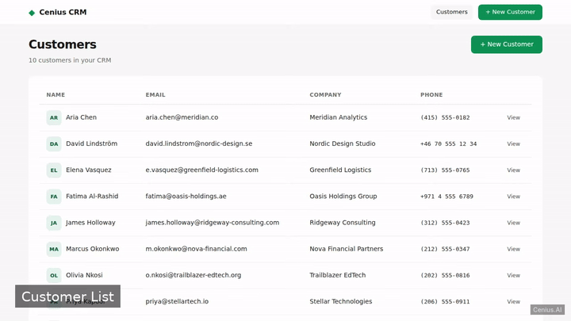
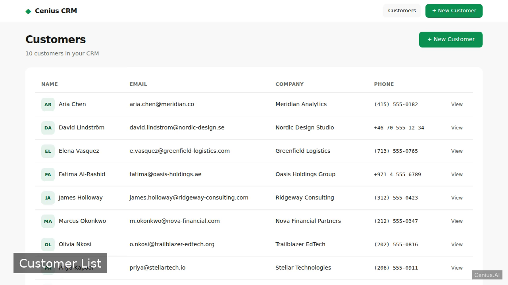
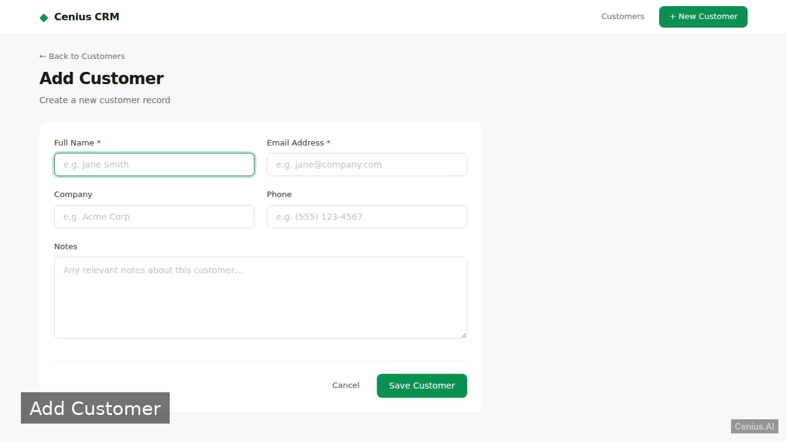

# Laravel CRM — complete V CRM system example app

**Laravel CRM** gives you two paths: self-host the Apache-2.0-licensed V source as your own CRM system, or [open it on cenius.ai](https://cenius.ai/marketplace/p/laravel-crm?ref=gh&utm_campaign=laravel-crm-vlang), describe the changes you want, and receive a new Laravel CRM build with full rebrand rights. A simple customer relationship management web app built with Laravel and SQLite for managing customer records. Everything ships in this repo — no paywall, no hidden features, no separate Laravel CRM download.


[](LICENSE)  [](https://cenius.ai)

[](https://cenius.ai/marketplace/p/laravel-crm?ref=gh&utm_campaign=laravel-crm-vlang)

> **▶ [Open & edit in cenius.ai](https://cenius.ai/marketplace/p/laravel-crm?ref=gh&utm_campaign=laravel-crm-vlang)** — one click to an editable workspace: describe changes in plain English, get an instant preview, one-click deploy and host. Modifications made on the platform come with full rebrand & relicense rights.

_Local clone? See [Quick start](#quick-start) below. cenius.ai is the zero-setup path._

## Demo



📽 **[Demo video on cenius.ai](https://cenius.ai/marketplace/p/laravel-crm?ref=gh&utm_campaign=laravel-crm-vlang)** — the complete run-through · [MP4](.github/media/demo.mp4)

## Screenshots

  

## Usage guide

Once the server is running (`php artisan serve`), open your browser at `http://localhost:8000`.

### Features

- **List all customers**  
  Visit `/customers` to see the list of seeded and added customers.

- **Add a new customer**  
  Go to `/customers/create` and fill in the form. On submission, the customer is stored and you are redirected to the list.

- **View customer details and notes**  
  Click a customer name on the list or visit `/customers/{id}`.

### API Endpoints (web interface)

All routes are defined in `routes/web.php` and handled by `App\Http\Controllers\CustomerController`.

| Method | URI                    | Action           | Description                  |
|--------|------------------------|------------------|------------------------------|
| GET    | `/customers`           | index            | List all customers           |
| GET    | `/customers/create`    | create           | Show add customer form       |
| POST   | `/customers`           | store            | Save new customer            |
| GET    | `/customers/{id}`      | show             | Show customer details + notes|

#### curl examples

- **List customers**
  ```bash
  curl http://localhost:8000/customers
  ```

- **Create a new customer** (fields depend on your form; example assumes `name`, `email`, `phone`, `notes` are present)
  ```bash
  curl -X POST http://localhost:8000/customers \
    -d "name=Jane%20Doe" \
    -d "email=jane@example.com" \
    -d "phone=555-0100" \
    -d "notes=New%20lead"
  ```

- **View customer details**
  ```bash
  curl http://localhost:8000/customers/1
  ```

_Full guide: [`USAGE.md`](USAGE.md)_

## Features

- View all customers
- View customer details and notes
- Add a new customer
- Seed demo customers

## Quick start

```bash
./install.sh   # installs dependencies + seeds demo data
```

See [`INSTALL.md`](INSTALL.md) for full setup and usage instructions.

## Architecture

The repository contains 5,447 files of V source, organised under `app/`, `bootstrap/`, `config/`, `database/`, `public/`, `resources/`, `routes/`, `storage/`. `install.sh` provisions dependencies and seeds demo data so the app starts with something real to explore. For environment-specific setup, see [`INSTALL.md`](INSTALL.md).

## FAQ

### What does it take to self-host Laravel CRM?

Everything you need ships in this repo: clone it, run `./install.sh` to install dependencies and seed demo data, then follow [`INSTALL.md`](INSTALL.md) to start it. No external services required.

### Does the Laravel CRM license allow commercial use?

The code is under the Apache-2.0 license, which allows commercial use without restriction. You can build, sell, and deploy it freely. Full text: [LICENSE](LICENSE).

### Is white-labeling Laravel CRM allowed?

Rebranding is straightforward under the MIT license — change what you want in the source. Or [open it on cenius.ai](https://cenius.ai/marketplace/p/laravel-crm?ref=gh&utm_campaign=laravel-crm-vlang): the platform handles the changes and grants full rebrand rights on the result.

### Is there a no-code way to modify Laravel CRM?

[cenius.ai](https://cenius.ai/marketplace/p/laravel-crm?ref=gh&utm_campaign=laravel-crm-vlang) handles the implementation. Tell it what you want in everyday words, pick up the updated build. No coding needed.

### How is Laravel CRM built technically?

Laravel CRM is a V application — and this repository holds the complete, runnable source, not a stripped-down sample. Highlights include add a new customer.

## License & rebranding

Released under the [Apache License 2.0](LICENSE) (© 2026 Cenius AI) — free for personal and commercial use. The Cenius name/logo are trademarks (see NOTICE).

**Need a customized version?** [Remix this app on cenius.ai](https://cenius.ai/marketplace/p/laravel-crm?ref=gh&utm_campaign=laravel-crm-vlang) — modifications made on the platform come with **full rebrand & relicense rights** over your derivative.

## Built with cenius.ai

This entire application — code, design, seeded demo data — was generated on **[cenius.ai](https://cenius.ai)** from a plain-English description.

- 🚀 [Build your own app on cenius.ai](https://cenius.ai)
- 🎛️ [Remix Laravel CRM on the marketplace](https://cenius.ai/marketplace/p/laravel-crm?ref=gh&utm_campaign=laravel-crm-vlang) — open it in a workspace, prompt for changes, and ship your own version.

More open-source apps: [the Cenius-ai catalog](https://github.com/Cenius-ai) · [showcase index](https://github.com/Cenius-ai/showcase)
